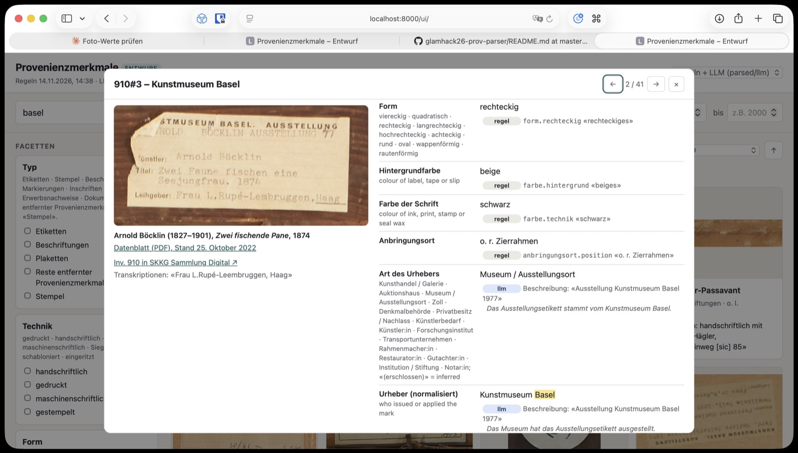

# glamhack26-prov-parser

For the [Provenance Pursuit](https://hack.glam.opendata.ch/project/304) challenge at [GLAMhack 2026](https://hack.glam.opendata.ch/event/13), this project extracts structured data from the provenance research data sheets (Provenienz-Datenblätter) of the Stiftung für Kunst, Kultur und Geschichte (SKKG), Winterthur, and parses the provenance marks (labels, stamps, inscriptions) they describe.

<p align="center">
  
</p>

## Pipeline

1. `scripts/extract_datenblatt.py` reads the PDF data sheets and writes JSON, CSV, Excel and images to `extracted/`.
2. `scripts/parse_merkmale.py` fills the physical columns of each provenance mark with rules and writes `parsed/`.
3. `scripts/llm_merkmale.py` fills the interpretive columns (issuer, place, event, owner, dates, language) with Claude and writes `parsed/llm/`. Every value has a trace that shows its source and evidence.
4. `ui/` is a search page for the parsed marks.

The column vocabulary is defined in `merkmal-schema.md`.

## Results

**`extracted/`**: the content of the 236 data sheets, one per work:

- `json/<Inventarnummer>.json`: one sheet with all eight sections (object, provenance, research, enquiries, archives, context, provenance marks), footnotes and image references.
- `datenblaetter.json`: all sheets in one file.
- `csv/`: one table per section, linked by `inventarnummer` (`objekte`, `provenienz`, `merkmale`, `literatur`, `fussnoten`, `bilder` and others). `datenblaetter.xlsx` holds the same tables as one sheet each.
- Images (`images/`) are not in the repository; the extraction script writes them.

**`parsed/`**: the 1,883 provenance marks, one row each:

- `llm/merkmale.csv` and `llm/merkmale.json`: **the final result**, rule values plus LLM values. The JSON also has a trace for every value (method, source, quote, reason) and a `lauf` block recording the scripts, model and prompt used.
- `llm/llm_probleme.tsv`: values the LLM proposed that were rejected, values read only from a photo (for review), and vocabulary proposals.
- Issuer and owner names are unified with `namen-normalisierung.tsv` (variant → standard name); the trace keeps the original form.
- `merkmale.csv` and `merkmale.json`: the rule layer only, an intermediate step. The interpretive columns are still empty here.
- `unbekannt.tsv`: words in the descriptions that no rule explained.

## Usage

The scripts declare their dependencies inline, so they run with [uv](https://docs.astral.sh/uv/) and no separate setup. The source PDFs are not part of this repository.

```sh
uv run scripts/extract_datenblatt.py Provenienz_Datenblatt extracted
uv run scripts/validate.py Provenienz_Datenblatt extracted
uv run scripts/parse_merkmale.py extracted parsed
uv run scripts/llm_merkmale.py parsed extracted parsed/llm --fotos   # needs ANTHROPIC_API_KEY
```

## Search UI

`ui/` is a static page with no build step. It searches the final marks (`parsed/llm/merkmale.json`) by full text, facets per column and a year range, and shows each value with its trace. Serve the repository root, because the page loads files from `parsed/`, `extracted/` and `Provenienz_Datenblatt/`:

```sh
python3 -m http.server 8000
```

Then open http://localhost:8000/ui/. Add `?data=../parsed/merkmale.json` to see the rule layer only. Mark photos and links to the PDFs appear only if `extracted/images/` and `Provenienz_Datenblatt/` exist locally.

## License

The code is released under the MIT License (see `LICENSE`). The source data belongs to the SKKG.
